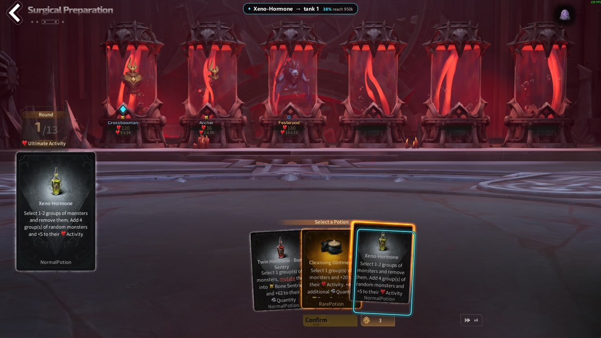
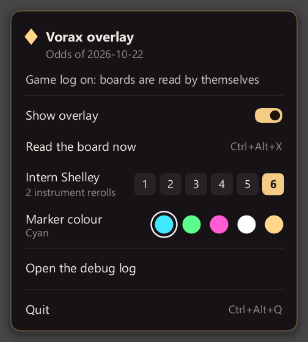

# Vorax Solver (Rust)

> **Unofficial fan project.** Not affiliated with or endorsed by XD Inc., the developer and publisher of
> Torchlight: Infinite. Game names and images belong to their owners. Use at your own risk.

A small Windows overlay for **Surgical Preparation**, the Vorax minigame of Torchlight: Infinite (SS11). It
follows your game, reads the board when it changes and marks the move the Solver advises: the card (or the
reroll) to take, the tanks to target, and how often that line reaches 840k.



Inspired by CoffeeBns's Tartarus Simulator and tidewarden's Vorax Solver (see [Credits](#credits)). Under the
overlay is a game engine, Solver and screen reader in Rust, and a Solver that plays 1,024 imagined games to the
end for every option (see [How far the Solver looks ahead](#how-far-the-solver-looks-ahead)).

**Read-only.** It reads the game window and the game's log file and draws on top. It never clicks or presses
keys, and it doesn't inject into or change the game: you make every move (see [AGENTS.md](AGENTS.md)). Changes
that add input automation won't be accepted.

## What it shows

- an outline on the card to take, or on the reroll button (cyan by default; five colours in the tray menu);
- a glowing outline on the glass of each tank to target;
- one small pill at the top with the move and how often it reaches 840k.

Nothing else is drawn, and nothing is drawn outside the Surgical Preparation screen. The marks only show while the
game is in front.

## Requirements

- **Windows 10 or 11.** The game borderless or windowed, not exclusive fullscreen.
- **The game's log turned on.** In the game: Esc → **Account Related** → **Enable Log**, then log out and back
  in. The overlay finds `UE_game.log` through Steam (or start it with `--log <path>`). The log only says *when*
  the board changes; everything else is read from the picture.

Card names are read with Windows' built-in text recognition: English when that language is installed, otherwise
your Windows language (tested with German). Without it, the pictures decide.

## Download

Get `vorax-overlay.exe` from the [latest release](https://github.com/DinoRaos/vorax-solver-rs/releases/latest) and run
it; there is nothing to install. Windows may say "Windows protected your PC" because the program isn't signed:
click **More info** → **Run anyway**. The release notes list each file's SHA-256 if you want to check your
download.

**Updates.** At start the overlay asks this project's GitHub releases once whether a newer version is out; nothing
about you or your games is sent. When there is one, the tray menu offers it with what's new, and **Update now**
downloads it, checks it against the SHA-256 GitHub gives for it, and restarts into it. It advises with the data
it was built with (see **Data** below); a new release brings any change.

## Build from source

You need [Rust](https://rustup.rs) (stable) and the Visual Studio Build Tools with "Desktop development with C++".

```powershell
git clone https://github.com/DinoRaos/vorax-solver-rs.git
cd vorax-solver-rs
cargo build --release                          # a few minutes the first time
.\target\release\vorax-overlay.exe
```

## Use

Start a Vorax game and the marks appear when the cards settle. Other ways to start it:

```powershell
.\target\release\vorax-overlay.exe --shelley 4   # your Intern Shelley level (default 6; remembered)
.\target\release\vorax-overlay.exe --selftest    # checks the log, the game window, a capture and the text reader
.\target\release\vorax-overlay.exe --demo        # a sample board's marks over the game for 15 s (switch to the game)
.\target\release\vorax-overlay.exe --preview shot.png out.png   # the marks drawn onto a saved screenshot
.\target\release\vorax-overlay.exe --frames D:\frames   # also saves every picture it reads (for reporting a misread)
```

| Key | |
|---|---|
| Ctrl+Alt+V | show or hide the overlay |
| Ctrl+Alt+X | read the board now |
| Ctrl+Alt+Q | quit |



The tray icon's menu has the same, plus your **Intern Shelley level** (1–6, remembered), the marks' colour, the
version and odds in use, and **Your runs**: every run the overlay read, newest first, with its instruments and how
the odds of reaching 840k went, opened board by board with a click (the advised move, the instruments, the
tanks). **Raw log** there opens the debug log itself (`%APPDATA%\VoraxRs\overlay.log`): attach it when reporting a
misread board.

When a card is still flying as the board is read, the overlay looks again a moment later (up to three times),
and hides its marks rather than leave ones for a board that's gone.

**Intern Shelley level.** It sets the instrument rerolls the advice counts on while they aren't on screen: a
potion board doesn't show them, so the overlay carries the count last read on an instrument offer, and before any
offer this game, the level's.

**Data.** The card odds (as of Oct 22, 2026), the board value and the screen reader's references are built in
(`data/`).

## How it works

1. **Log** (`crates/vorax-scan/src/live.rs`): follows `UE_game.log` every 250 ms; its lines say when a new board
   has settled.
2. **Picture**: Windows Graphics Capture of the game window only, started for that board and stopped after,
   frames grabbed until two in a row look alike; cut to the game's client area; no mouse, and on Windows 11 no
   yellow border.
3. **Reading** (`crates/vorax-scan`): tanks, cards, round, rerolls, instruments and the instrument tracker, with
   card titles read by Windows' OCR and the pictures deciding where a title doesn't settle. About 0.5 s per board.
4. **Advice** (`crates/vorax`): the Solver's look-ahead on every core, up to about a quarter second on the hardest
   boards (12 threads), most in well under 0.1 s.
5. **Overlay** (`crates/vorax-overlay`): a transparent, click-through, topmost window over the game's picture,
   shown only while the game is in front, redrawn only when the advice changes.

## How far the Solver looks ahead

For every option (each card on its best tanks, the next best plays, a reroll) the Solver plays imagined games to
the end: random next hands from the card odds, random outcomes, later choices judged by the board value (see
below). It counts how many reach 840k (the "% reach 840k" in the pill) and advises the option that did best. Each
imagined game is one "future"; the more of them, the less a close call between two options comes down to luck in
the Solver's own futures. The same 3,000 games, played with the Solver's full advice:

| Board value | Futures per option | Reached 840k | Hardest recorded board, 12 threads |
|---|---|---|---|
| Linear | 64 | 69.3% | 0.01 s |
| Trees | 64 | 71.8% | 0.06 s |
| Linear | 256 | 78.9% | 0.05 s |
| Trees | 256 (v0.2.0) | 79.2% | 0.28 s |
| Trees | 512 | 81.0% | 0.55 s |
| **Linear (built in)** | **1,024** | **81.5%** | **0.20 s** |

From 64 to 1,024 futures, 12 more games in a hundred reach 840k (a split that uneven by luck is less than a 0.1%
chance); against v0.2.0, 2.3 more (1.4%), with the advice ready sooner. On fewer cores the time grows in
proportion (8 threads: about 0.3 s on the hardest board), most boards being several times faster.

## Why Rust

An overlay that sits next to the game all evening asks for:

- **Speed.** The Solver's look-ahead plays out many futures for every option, and every future rates thousands of
  boards; on all cores even the hardest board's advice is ready in about a fifth of a second. The game state is a
  fixed-size value that copies in a single memcpy, and [rayon](https://github.com/rayon-rs/rayon) spreads the
  futures over every core.
- **Reading in about 0.5 s.**
- **One small program.** A ~5 MB exe with no runtime, browser or Electron, idle while the board doesn't change.
  It uses what Windows already has: Windows Graphics Capture for the game window alone, Windows OCR for card
  titles, and a layered window for the marks.
- **Training at scale.** The same engine plays thousands of simulated games a second, so the board value learns
  from millions of them.

## The board value

Inside the futures, the Solver judges where a board is headed by its board value: the final score (counted up to
840k) that games from a board like it tend to reach, given its monsters, instruments and round. The one built in
is linear, 656 weights per round, fitted on simulated games.

We also trained 120 decision trees (gradient boosting, fitted with [LightGBM](https://github.com/microsoft/LightGBM))
on 30 million boards from 1.5 million simulated games. With 64 futures per option they did better: 72.1% of 6,000
games reached 840k against 68.9% (luck: less than 0.1%), and v0.1.6 to v0.2.0 shipped them. With more futures the
Solver leans on the board value less, and at 256 the two are even (79.2% and 78.9% of 3,000 games, luck: 80%),
while the trees take five times as long to evaluate. So the time goes into futures: the linear board value at
1,024 futures beats the trees at 256 and matches them at 512 (table above).

```powershell
.\target\release\vorax train --games 2000000 --out linear.json    # a linear board value, fitted here
.\target\release\vorax train --games 1500000 --rows boards.bin    # boards as rows, for fitting trees
.\target\release\vorax sim --policy solver --futures 1024 --games 3000 --model a.json --scores a.txt
.\target\release\vorax gate built-in.txt a.txt                    # seed by seed: more games reaching 840k?
.\target\release\vorax sim --policy solver --futures 1024 --model b.json --against a.txt   # stops once it's clear
```

`--against` is a sequential test (as chess engines test their changes): the challenger plays the champion's games a
batch at a time and stops as soon as it's clearly better or not (5% error each way), so a clear result takes a
fraction of the games. One idea it ruled out: spending the futures by successive halving (dropping the worse half
of the options round by round) reached 840k in 80.1% of 1,440 games against 81.6% for every option alike.

## The `vorax` command

```powershell
.\target\release\vorax advise screen.json      # the Solver's advice for a screen (ScreenState JSON)
.\target\release\vorax advise --quick < s.json # this round's expected score only
.\target\release\vorax read shot.png --advise  # read a screenshot of the game (and advise on it)
.\target\release\vorax sim --games 1000 --policy value   # value | steer | solver (--futures N, as the overlay: 1024)
.\target\release\vorax bench fixtures          # advice timings on the 8 recorded screens
.\target\release\vorax info                    # the data in use
```

`--model <model.json|none>` on any command plays with another board value.

## Tests

`cargo test --release --workspace` replays recorded traces, so a change can't make the engine, Solver or reader
play differently by accident:

- 300 random games (normal and sandbox starts, every instrument), 11,627 actions: the full state after every
  action, including the RNG state, board value and build progress;
- 60 boards: options, expected values (with rollouts, steering and the board value), choices, shortlists,
  potion and instrument futures, and the instrument picker;
- 8 screens: the Solver's full advice (64 futures per option) and its quick advice;
- 8 whole games played by the bots;
- the screen reader on 6 test frames, each as it is, shrunk to 3/4 and recoloured (every field, score, problem
  and ranking, the card titles with three stand-in text readers, and the instrument tracker through a game), and
  the log settler on a recorded game log.

Everything matches exactly, floats included. The tests play with the linear board value the traces were recorded
with (`fixtures/boardValue-linear.json`, the one built in), and also check that a board's features give exactly
what it computes.

## Speed

Solver advice on the 8 recorded screens with 1,024 futures: up to 0.2 s a screen on 12 threads, up to about 1.4 s
on one core. Whole games: about 20,000 a second with the board-value bot; a game with the Solver's full advice at
every move (1,024 futures) takes about 3 s per game when 12 cores each play their own.

## Layout

| Path | What |
|---|---|
| `crates/vorax` | engine (`game.rs`, `context.rs`, `effects.rs`), board value (`value.rs`), bots (`bot.rs`), Solver (`advisor.rs`) |
| `crates/vorax-scan` | screen reader, instrument tracker and log settler (`scan.rs`, `titles.rs`, `track.rs`, `live.rs`) |
| `crates/vorax-overlay` | the overlay: `draw.rs` (the marks), `pipeline.rs`, and `app/` (capture, OCR, window, tray menu, your runs, updates) |
| `crates/vorax-cli` | the `vorax` command, and training (`train.rs`) |
| `data/` | cards, odds, the board value; `data/scan/` the reader's references |
| `fixtures/` | what the tests replay: recorded traces, the linear board value, test screenshots and a game log |

## Credits

Inspired by:

- **CoffeeBns's [Tartarus Simulator](https://github.com/blahdot3h/tartarus-simulator)**
  ([twitch.tv/coffeebns](https://twitch.tv/coffeebns)): following the game's log and reading the game window,
  the approach this overlay follows. No code from it is used here.
- **tidewarden's [Vorax Solver](https://github.com/tidewarden/tli-vorax-simulator)**: the game engine, Solver,
  screen reader and data here began as a Rust port of its last open version (7b4c9ba, Oct 22, 2026, MIT), itself
  based on [Moebing's Vorax simulator](https://github.com/Moebing/Torchlight-Infinite-SS11-Vorax-simulator)
  (MIT). Nothing from it after that version is used.

## License

[MIT](LICENSE): use, copy, change and share it freely, keeping the copyright and license notice. The notice keeps
tidewarden's and Moebing's copyright lines, as their MIT license requires for work built on theirs.
